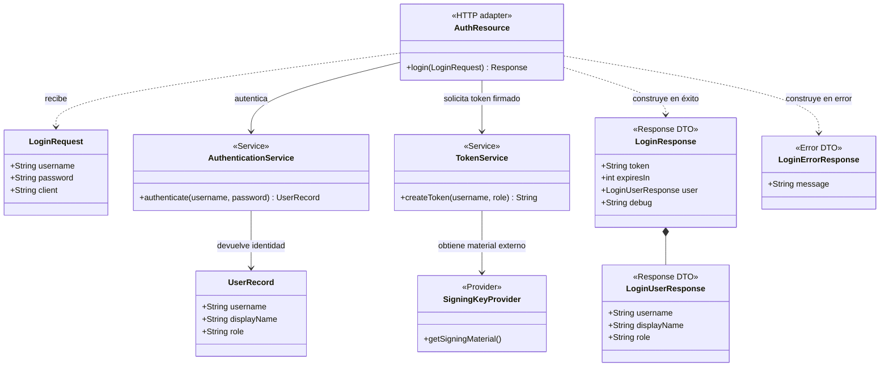

# HU-01 — Diagrama de clases propuesto

El diagrama representa el diseño objetivo de HU-01; `TokenService`,
`SigningKeyProvider` y los DTO de respuesta son responsabilidades propuestas,
no clases que se afirme que ya existen. Se conservan los campos y validaciones
de entrada documentados. El formato firmado del token requiere coordinación
con sus consumidores antes de implementarse.

**Patrones de diseño/modelado:** `LoginRequest`, `LoginResponse` y
`LoginUserResponse` son DTO; `AuthResource` actúa como adaptador HTTP;
`AuthenticationService` y `TokenService` separan responsabilidades de
servicio; `SigningKeyProvider` encapsula la obtención de material externo.
Son responsabilidades propuestas para el diseño objetivo, no una afirmación
de que ya estén implementadas.

## Restricciones de entrada

| Campo | Tipo | Restricción |
|---|---|---|
| `username` | string | Patrón semántico actual: requerido, no nulo y `!value.trim().isEmpty()` usando `String.trim()` de Java. Autenticar usando el valor original. No hay regex ni límites de longitud definidos. |
| `password` | string | Patrón semántico actual: requerido, no nulo y `!value.trim().isEmpty()` usando `String.trim()` de Java. Autenticar usando el valor original. No hay regex ni límites de longitud definidos. |
| `client` | string | Opcional; puede omitirse o ser `null`. Actualmente no se usa para autenticar. No hay regex ni límites definidos. |
| Cuerpo | JSON | Un cuerpo `null` produce 400. Los campos JSON desconocidos se ignoran según la configuración actual. |

No se agregan anotaciones `@Pattern` ni expresiones regulares porque no están
definidas por el contrato/código actual; hacerlo impondría reglas nuevas.

## Restricciones de salida

### Éxito

- HTTP 200 con JSON que contiene `token`, `expiresIn`, `user` y `debug`.
- `expiresIn` permanece en 3600 segundos.
- `user` contiene `username`, `displayName` y `role`; `displayName` se escapa con HTML4.
- El token debe ser verificable criptográficamente y no incluir secretos en su contenido. El formato y su compatibilidad con consumidores deben acordarse antes del cambio.

### Errores documentados del endpoint

- HTTP 400 para cuerpo nulo o campos requeridos inválidos.
- HTTP 401 para usuario inexistente o credenciales incorrectas.
- HTTP 500 para excepciones internas; el contrato actual expone detalles y la HU no autoriza cambiar esa respuesta.

Fuentes: [HU-01.md](HU-01.md), [ENDPOINTS.md](docs/ENDPOINTS.md),
[LoginRequest.java](src/main/java/com/bcp/workshop/auth/LoginRequest.java) y
[AuthResource.java](src/main/java/com/bcp/workshop/auth/AuthResource.java).
